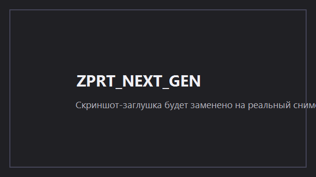

# ZPRT_NEXT_GEN

[](https://github.com/Benny4ip/ZPRT_NEXT_GEN/actions/workflows/build.yml)

Русскоязычная графическая оболочка для управления `winws.exe` из
[`Flowseal/zapret-discord-youtube`](https://github.com/Flowseal/zapret-discord-youtube):
пресеты, статус подключения, проверка связи и анимация «просветления» при подключении.

> Релиз собирается вручную (`workflow_dispatch`); автоматических релизов нет.



## Что это

ZPRT_NEXT_GEN — WPF-оболочка вокруг `winws.exe` (движок обхода блокировок из проекта zapret).
Она запускает `winws.exe` с выбранным пресетом, следит за состоянием процесса, отображает
статус подключения (включая анимацию «просветления» в состоянии Connected), проверяет
доступность Discord/YouTube, умеет свертываться в трей и добавляться в автозапуск
через задание планировщика Windows.

## Возможности

* Групповой выбор пресетов (Обычные / Fake TLS / Simple Fake / Экспериментальные).
* Включение/выключение обхода одной кнопкой; отображение статуса движка и анимация состояния.
* Проверка связи («Проверить связь») — доходность целевых ресурсов.
* Сворачивание в трей с иконкой, окно «О программе», возврат из трея.
* Автозапуск через задание планировщика (`schtasks`).
* Настройки хранятся в `%APPDATA%\ZPRT_NEXT_GEN\settings.json`.
* Тёмная тема, опция «Уменьшить анимацию».

## Требования

* Windows 10 или Windows 11 (x64).
* Права администратора (обязательны для работы WinDivert драйвера; запрашиваются через UAC при запуске).
* .NET не требуется у пользователя — релиз собирается как self-contained single-file.

## Быстрый старт

1. Скачайте последний zip-архив релиза (`ZPRT_NEXT_GEN-<version>-win-x64.zip`).
2. Распакуйте архив в любую папку (путь может содержать пробелы и кириллицу).
3. Запустите `ZprtNextGen.exe` от имени администратора (первый запуск запросит права через UAC).
4. В окне приложения выберите пресет (по умолчанию «Основной») и нажмите «Включить».
5. Движок `winws` стартует, анимация перейдёт в состояние Connected.

## Выбор пресета

Пресеты берутся из файла `presets\presets.json` рядом с приложением. «Основной» — базовый набор для Discord, YouTube и общих списков; рекомендуется начинать с него. Остальные варианты (альтернативы, Fake TLS, Simple Fake, экспериментальные) — другие комбинации стратегий обхода.

## Проверка связи

Кнопка «Проверить связь» запускает проверку доступа к целевым ресурсам и отображает результат для каждой группы (зелёный — доступно). Проверка выполняется с небольшим таймаутом; только вторичные успешные ответы считаются частью общей оценки.

## Трей и автозапуск

* Закрытие окна свертывает приложение в трей (по умолчанию); из трея окно можно восстановить двойным кликом по иконке.
* «Выход» из трея останавливает `winws` (если запущен оболочкой) и завершает приложение.
* Автозапуск создаёт задание в планировщике Windows (`ZPRT_NEXT_GEN`). Включить/выключить можно в окне настроек; состояние проверяется через `schtasks /Query /TN ZPRT_NEXT_GEN`.

## Предупреждение об антивирусе и WinDivert

Движок использует WinDivert (`WinDivert.dll` / `WinDivert64.sys`) для перехвата трафика, поэтому некоторый антивирус может сработать на `winws.exe` или на самозаверяющий драйвер — это ложное срабатывание, характерное для инструментов сетевого перехвата. Добавьте папку с приложением в исключения антивируса, если проверка не проходит. Для работы требуются права администратора.

## Как собрать

Из корня репозитория (.NET 10 SDK):

```powershell
dotnet build src/ZprtNextGen.App -c Release
```

Сборка каталога пресетов из папки движка zapret (запускает `tools/ZprtNextGen.PresetTool`):

```powershell
tools\Import-Presets.ps1 -Engine <путь-к-движку> -Out presets\presets.json
```

Упаковка релиза (требует предварительного `dotnet publish -c Release`):

```powershell
dotnet publish src/ZprtNextGen.App -c Release
powershell -NoProfile -ExecutionPolicy Bypass -File tools\Pack-Release.ps1 -EngineDir <путь-к-движку> -Version 0.1.0
```

Итог: `publish\ZPRT_NEXT_GEN-0.1.0-win-x64.zip`.

## Структура репозитория

```
ZPRT_NEXT_GEN/
├── .github/workflows/      # CI: build (push/PR), release (workflow_dispatch, вручную)
├── assets/                 # иконка приложения (icon.ico, icon.svg)
├── docs/                   # скриншот-заглушка (screenshot.png)
├── licenses/               # лицензии сторонних компонентов
├── presets/                # presets.json — каталог пресетов winws
├── src/
│   ├── ZprtNextGen.App/    # WPF + WinForms приложение (net10.0-windows)
│   └── ZprtNextGen.Core/   # ядро: пресеты, движок, сеть, настройки, автозапуск
├── tests/                  # юнит-тесты (xUnit)
├── tools/
│   ├── Pack-Release.ps1    # упаковка релиза (PowerShell 5.1, UTF-8 с BOM)
│   ├── Import-Presets.ps1  # импорт пресетов из zapret
│   └── ZprtNextGen.PresetTool/   # CLI-инструмент сборки presets.json
├── LICENSE                 # MIT (оболочка)
├── THIRD-PARTY-NOTICES.md  # атрибуция upstream
└── README.md
```

`bin/`, `obj/`, `publish/`, `engine/`, `*.exe`, `*.dll`, `*.sys`, `*.zip` не попадают в git (см. `.gitignore`).

## Лицензия и атрибуция upstream

Оболочка ZPRT_NEXT_GEN — лицензия MIT, copyright (c) 2026 Benny4ip.
Движок `winws` и сопутствующие файлы берутся из upstream-проекта
[`Flowseal/zapret-discord-youtube`](https://github.com/Flowseal/zapret-discord-youtube)
и распространяются под его лицензией; полная атрибуция — в
[`THIRD-PARTY-NOTICES.md`](THIRD-PARTY-NOTICES.md) и `licenses/zapret-LICENSE.txt`.

## Дисклеймер

Программное обеспечение предоставляется «как есть» без гарантий. Использование средств
обхода сетевых ограничений может подлежать ограничению законодательством вашей страны или
политикой вашего провайдера; несёте ответственность за соблюдение применимых правил.
Авторы не несут ответственности за последствия использования.
